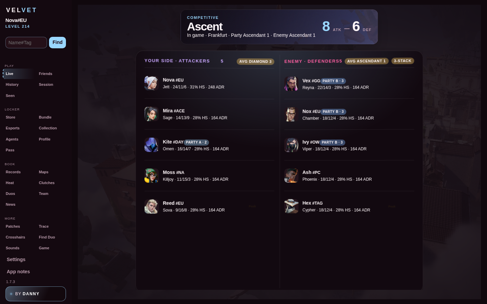
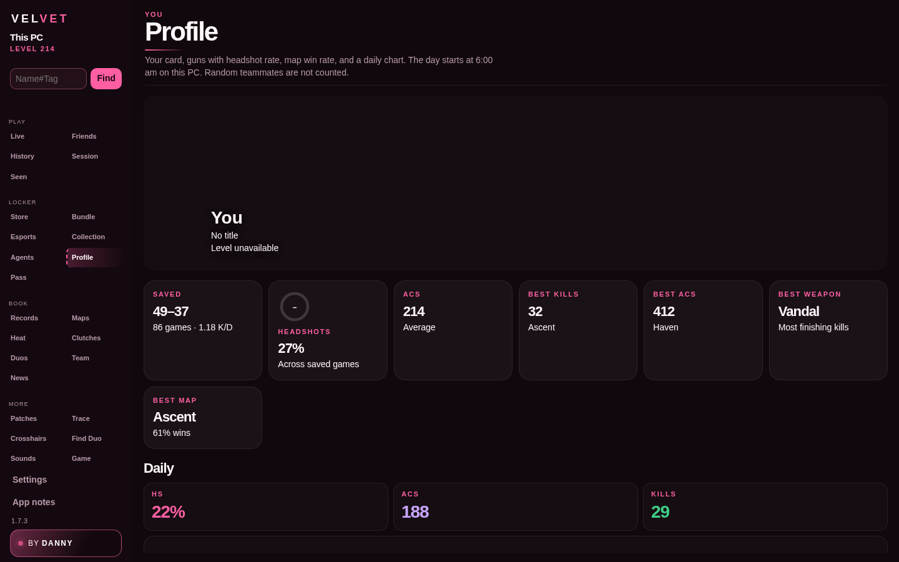

# Valvet

Valvet is a Windows app for the Valorant account already signed in on that PC. It does not ask for a Riot password, and it is not made by Riot Games.

Open the Riot Client, then open Valvet.

## Install

1. Download [ValvetSetup.exe](https://github.com/qdxnnyq/valvet/releases/latest/download/ValvetSetup.exe).
2. Choose a folder. The suggested folder is `%LOCALAPPDATA%\Valvet`.
3. The installer adds Start menu and Desktop shortcuts named Valvet, then opens the app.
4. Leave the Riot Client open on the same PC.

Windows SmartScreen can warn the first time. The build is unsigned. Download it from this GitHub release.

Settings and saved games stay on this PC. Updating does not delete them. Uninstall from Windows Apps removes the program and the shortcuts, and asks before deleting saved games.

The first open is a short tour of the pages. Later updates show what changed. They do not start the tour again. Replay tutorial is in Settings.

## Updates

The installer is only for the first setup. After that, a newer version is a pink bar in the app. That downloads the new app and restarts. You do not run the installer again.

## Live

During agent select and in a match, your side is on the left and the other side is on the right. Each player shows agent, rank, RR, KDA, headshot percent, and ADR. The header is the average rank of that side. A player with no rank this act shows their peak, marked Peak. A duo or a three-stack keeps its party mark.

The phase line shows the server, the two averages, and your record on the current map. One daily goal is taken from your recent games. Today on this page starts at 6:00 am.

When the match ends, a result card can be copied as a picture.

## Friends

Friends are split into Valorant, League, and the Riot Client. Someone in your party shows with your Valorant friends. If nobody else is in Valorant, the page says you are so lonely.

## History

History keeps this act. The next act replaces it. Duos, clutches, heat, and records use the same act.

Queues can be filtered. Inside a finished match, each side is sorted by KDA, best first. Highlight a name and the same person lights up in the stats. MVP is the best KDA on the winning side. SVP is the best KDA on the losing side.

A finished match shows each round: whether you won it, how it ended, and which side you were on. The match can be copied as an image. Search stays with the page.

## Profile

The card, title, level, and agent mastery are the account on this PC. Under that, the act: friend win rate, weapons, maps, and a chart for headshot percent, ACS, and kills.

Friend win rate counts Riot friends, after two games together. Weapons show finishing kills and headshot percent. Maps show win rate. A day on the chart starts at 6:00 am. Older days stay behind View more.

## Book

- **Records.** Totals, bests, form, and agents from this act.
- **Maps.** The minimap for each map. Bigger fits the picture in the window. Esc or Close leaves it.
- **Deaths.** Where you died, on the same minimap.
- **Heat.** Where kills landed.
- **Clutches.** Hold rate, then each 1vX. Older rounds stay behind View more.
- **Duos.** Riot friends only, with the time you have played together.
- **Session.** The last 30 days of play time. Click a day for that day's matches. The clock is time since 6:00 am.
- **Seen.** Green is on the client or in a game right now, with where they are. Yellow is AFK. The rest is the last time and place. Riot Mobile is ignored.
- **Roster.** A custom list you keep yourself.

## Store and locker

Store is the daily offers, Kingdom Credits, and the night market. Wishlist pins stay at the top when they are in the shop. The wallet groups VP, Kingdom Credits, and Radianite, and each list stays closed until you open it.

The featured bundle is its own page. Esports is the current and upcoming events, moved with Previous and Next. A card opens the event page. Capsules open to the items inside.

Loadout is what you have equipped. Changing it asks you to confirm. Agents, the battle pass, missions, patch notes, and news each have their own page. The pass shows level, XP, and the time left in the act. Reward tiles stay square. A free pass, when Riot ships one, shows beside the current one.

News is recent Valorant posts. Open a card to read it on playvalorant.com. Patch notes open from the link at the top of the page.

## Game

The Game page is the graphics and the sensitivity from the Valorant menu on this PC. Copy puts the list on the clipboard.

Type your mouse DPI, or pick 400, 800, 1600, or 3200. Valvet shows eDPI, centimetres per 360, and inches per 360. Want eDPI tells you the sensitivity to set for that DPI.

Crosshairs are codes you paste and name. Export copies the set. Valvet does not read the crosshair out of Valorant.

## Trace

- **Watch list.** Any Name#Tag. If they are in your lobby or your match, the row is marked and a sound can play. If they finish a match you were not in, Valvet tells you once.
- **Unfriends.** A Riot friend who was there, then was not.
- **Name changes.** The old Riot ID and the new one.
- **Wallet.** VP, Kingdom Credits, and Radianite, with the time the balance changed.

## Find Duo

Find Duo is in beta. It is a board, not a live queue. You post the roles, modes, server, queue, rank range, and an optional note. Age and gender are optional, and the board can be filtered by them. Do not post if you are under 16.

After you play with someone, you can rate them from 1 to 5. The leaderboard is people with a strong rating and more saved games. A post stays up for about 12 hours. Your name is shared only if you turn that on.

## Sounds

Friend in your match, watch list, wishlist, win, and loss each have their own sound. Any of them can be set to none, or replaced with a file on this PC. Win and loss have their own volume, separate from the rest. They play when the match result is in, not when a round ends.

Quiet hours mute the alerts, including win and loss. Preview plays the sound you picked.

## Look

Settings has colour presets. You can also upload a picture and Valvet takes the colours from it. Clear goes back to the preset.

Live only keeps the match and leaves the other pages off. The overlay is a small window that stays on top, with the score and any watch-list names in the current lobby or match.

## Contact

Bug reports and feedback go from Settings. [Twitter](https://x.com/qdxnnyq).
