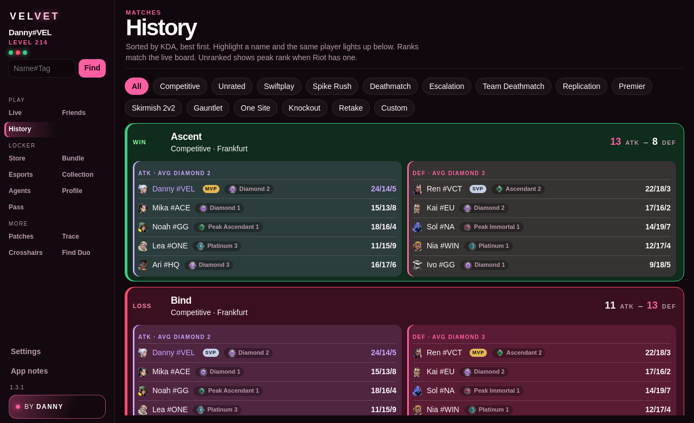
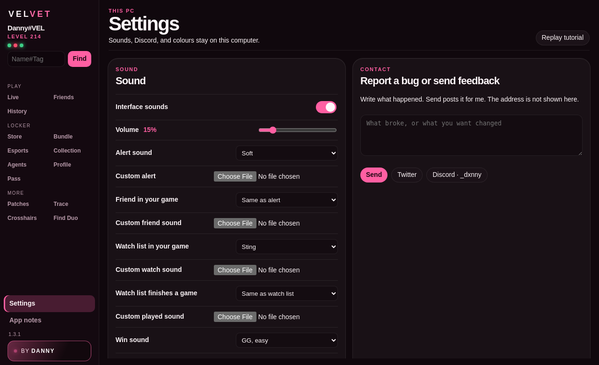

# Velvet

Velvet is a local Windows companion for the Valorant session already running on that PC. It reads the Riot Client lockfile, then uses the local port and token the client already created. It does not ask for a Riot password, it does not inject into the Valorant process, and it is not made by Riot Games.

The file is not bound to an account. Velvet can only see the account signed into the Riot Client on that machine.

## Install

1. Download [VelvetSetup.exe](https://github.com/qdxnnyq/velvet/releases/latest/download/VelvetSetup.exe).
2. Run it. The installer copies `Velvet.exe` to `%LOCALAPPDATA%\Velvet`, creates Start menu and Desktop shortcuts, and launches the app.
3. Keep the Riot Client open on the same PC.

Windows SmartScreen can warn the first time. The build is unsigned. The file to trust is the `VelvetSetup.exe` asset attached to the GitHub release.

Settings, the saved match archive, and custom audio live in `%LOCALAPPDATA%\Velvet`. They are not compiled into the exe. A new install with no saved volume starts at 15%.

## Updates

The installer is for the first setup. After that, Velvet reads `version.json` in this repository. A newer build is a pink bar inside the app. That action downloads the `Velvet.exe` asset from the matching release, replaces the installed binary, and restarts. It does not download the installer again.

## How a read works

Startup finds the Riot Client lockfile and keeps a short-lived session from it. Live state is polled from that session: phase, map, mode, server, score, and the current roster.

Competitive rank is a separate MMR request per player. A known rank is cached for several hours. An unknown rank is retried sooner. If the current act has no competitive tier and Riot still returns a peak tier, the UI labels that peak and does not treat it as current RR.

Match history uses the same session and the same rank fields as the live board. A name that arrives late stays on the row it was already drawn into, so identities do not swap while the request is in flight.

## Live

During agent select and in game, each side shows agent, KDA, headshot percent, ADR, rank icon, rank, and RR. The side header is the average competitive tier on that side. An unranked player with a stored peak is labeled Peak and still counts toward that average. Enemy groups of two or more are marked as a stack.

The phase line shows server, party average, enemy average, and this PC's record on the current map. A daily challenge is computed from recent games.

## Match history

Queues are filterable. Inside a finished match, each side is sorted by KDA, highest first. Highlighting a name highlights the same player in the stat table. MVP is the best KDA on the winning side. SVP is the best KDA on the losing side. Opening a player shows that MVP mark on their older games as well.

History ranks are the same MMR result as the live board, including the Peak label and the side average. A finished match can be copied as an image.

## Profile

The player card, title, level, and agent mastery come from the local account. Under that, Velvet keeps an on-disk archive of up to 100 decided games.

Friend win rate counts only Riot friends, and only after two decided games together. Random teammates are excluded. A rival is an enemy faced at least twice. Each weapon shows finishing kills and headshot percent. Each map shows its win rate. A daily chart tracks HS, ACS, and kills. A new day starts at 6:00 on this PC.

## Trace

Trace is not match history.

- **Watch list.** Any `Name#Tag`, friend or not. If they are in your lobby or your match, the row is marked and the watch-list notification can play. If they finish a match you were not in, Velvet reports that new match id once.
- **Unfriends.** Riot friends present on one read and missing on the next.
- **Name changes.** The previous Riot ID and the new one.
- **Wallet.** Timestamped deltas for VP, Kingdom Credits, and Radianite when the store balance changes.

The wishlist is a pin list across weapon skins and the Kingdom Credits catalog. If a pinned item is in the daily store or the night market, it is sorted to the top of Store.

## Locker

Store covers daily offers, Kingdom Credits, and the night market. The featured bundle, esports capsules, equipped collection, agent kits, battle pass, missions, and patch notes are separate pages. Esports events are a grid, largest prize first, then the smaller ones. Capsules open to the items inside. If Riot ships a free pass, it shows on the Pass page next to the current one. Crosshairs are import and export of a code. Velvet does not read the crosshair from the game config.

The Game page reads the graphics and sensitivity Valorant is using on this PC. Copy puts that list on the clipboard.

A background image can recolor the app from the picture. The optional overlay is a small always-on-top window with the score and any watch-list names in the current lobby or match. It is not click-through. Live-only mode loads Live and Settings and skips the rest. Discord can take a channel webhook for the map, a found game, the final score, a watched player, or an unfriend.

## Find Duo

Roles, modes, rank range, and server are set first. **Start looking for duo** posts this PC to the shared list. **Stop looking** removes the post. Discord is included only when Share Discord is on.

Settings also creates a private id. That id is a second channel between two installs: queue, map, score, shared wishes, and watch-list pings. It is not the public Find Duo list.

## Sounds

Alerts, a friend appearing in your match, a watched player appearing in your lobby or match, a watched player finishing their own match, wishlist, win, and loss are separate controls. Win and loss play only after the match result is written, not when a round ends. A round only flashes the window edge. Changing tabs does not play a sound.

Quiet hours mute the alerts. They do not mute the post-match win or loss. Any of those sounds can be replaced with a local file. Preview plays the selected file immediately.

## Install notes

VelvetSetup.exe adds Velvet to Windows apps, the Start menu, and the Desktop. Uninstall from Apps removes the program and the shortcuts. Saved games stay in `%LOCALAPPDATA%\Velvet`.

Agents, patches, the battle pass, and the esports list open from a copy saved on this PC, then refresh when the source changes.

Bug reports go from Settings. The address is not shown. [Twitter](https://x.com/qdxnnyq) and Discord `_dxnny`.

