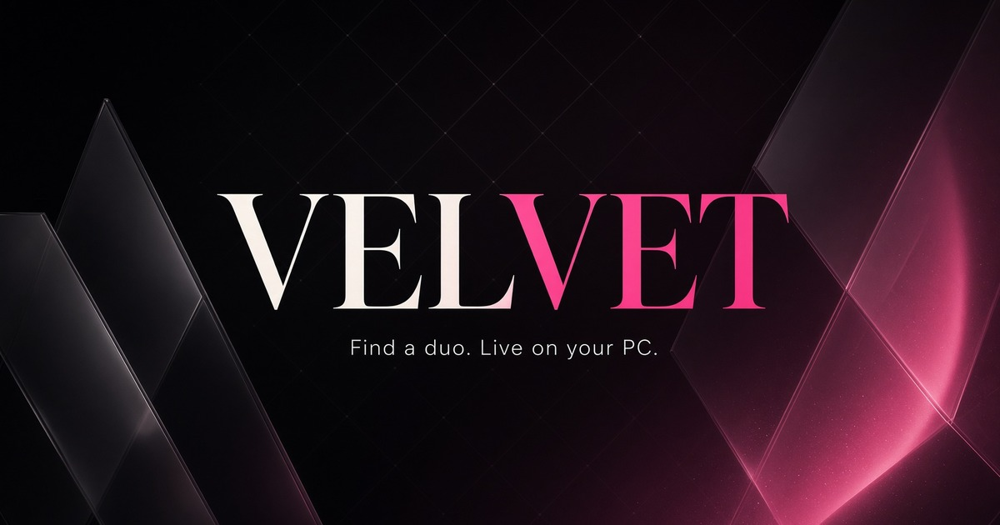

  

# Velvet

A Windows app for your own Valorant client. Live lobby, history, store, collection, and an opt-in Find Duo list.

**[Download Velvet.exe](https://github.com/qdxnnyq/velvet/releases/latest/download/Velvet.exe)** · [Release notes](https://github.com/qdxnnyq/velvet/releases/latest)

Windows SmartScreen can warn on an unsigned test build. The file is this release, not a random download.

## What it does

Open the Riot Client, then open Velvet. The first launch is a short tour of every tab. The app reads the client on that PC. A friend who installs the same file sees their account, not yours.

## Updates

They only download from this page once. The app checks this repo about every 10 seconds. A newer build shows a pink bar at the top. One click replaces the exe and restarts. If Velvet is closed, the bar shows the next time it opens.

## Find Duo

People who are not friends appear only if they turn on **Show me in Find Duo**. That posts a small card to a public list every Velvet app reads: Riot ID, rank, server, roles, and modes. Discord is on the card only if they also turn on Share Discord. Turn it off and the posts stop.

A private share is separate. In Settings, **Share Velvet with a friend** is a random id. Only someone you send that id to can see your queue, map, score, wishes, and watch-list pings.

Your Riot password stays on the PC. Velvet is not made by Riot Games and it does not inject into the game.

  

